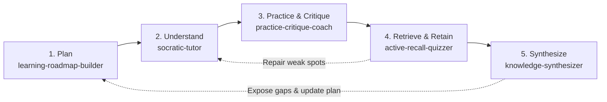
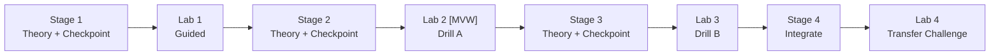

# LearningSkill

**English** | [Tiếng Việt](README.vi.md)

[](#the-5-skill-learning-loop)
[](#works-across-every-domain)
[](#multilingual-by-default)
[](https://github.com/lochuung/learning-skill/actions/workflows/validate.yml)
[](LICENSE)

> **Turn your AI agent into an evidence-based, personalized learning system for *any* field** — from programming and certifications to languages, finance, design, writing, and public speaking.

Most AI study prompts produce generic outlines and passive walls of text. **LearningSkill** is a modular suite of 5 interoperable Agent Skills grounded in cognitive science — **Backward Design, Socratic Tutoring, Deliberate Practice, Active Recall, Spaced Repetition, and the Feynman Technique** — so you don't just consume information, you actually retain and apply it.

---

## The 5-Skill Learning Loop

Each skill covers one distinct stage of mastery. Use them individually or together as a complete closed-loop system:



| # | Skill | Stage | What It Does | Example Prompt |
| :-: | :--- | :--- | :--- | :--- |
| 1 | **[learning-roadmap-builder](skills/learning-roadmap-builder/SKILL.md)** | **Plan** | Interviews you, diagnoses your real level with probes, classifies the domain archetype, and generates a personalized multi-phase Markdown study repo (notes, domain-native practice, rubrics, MVW fallback, tracker). | *"Build me a 10-week roadmap to learn financial statement analysis from scratch, 5h/week."* |
| 2 | **[socratic-tutor](skills/socratic-tutor/SKILL.md)** | **Understand** | Teaches any concept interactively using analogies from your background, diagrams, worked examples, and Socratic micro-checks instead of dumping walls of text. | *"Teach me how options pricing works interactively — I'm a software engineer."* |
| 3 | **[practice-critique-coach](skills/practice-critique-coach/SKILL.md)** | **Practice & Feedback** | Generates progressive deliberate practice drills, runs interactive roleplays/simulations, and grades your work against an observable 1–3 rubric with concrete rewrites + a 10-min follow-up drill. | *"Critique my product strategy memo against a strict rubric"* or *"Roleplay a salary negotiation with me."* |
| 4 | **[active-recall-quizzer](skills/active-recall-quizzer/SKILL.md)** | **Retrieve & Retain** | Runs adaptive closed-book quizzes, timed exam mini-mocks, and spaced-repetition reviews across Bloom's taxonomy, explaining why distractors fail and logging weak areas. | *"Quiz me on Week 2 without showing answers first, and track my weak spots."* |
| 5 | **[knowledge-synthesizer](skills/knowledge-synthesizer/SKILL.md)** | **Consolidate** | Runs interactive Feynman Teach-Back audits and distills messy notes/readings into Atomic Concept Notes, Comparison Matrices, Mermaid Concept Maps, and One-Page Cheat Sheets. | *"Audit my Feynman explanation of TCP congestion control"* or *"Turn these notes into a 1-page cheat sheet."* |

---

## Weekly Layout: Stages → Labs

Every generated week is split into **3–4 Stages** (Vietnamese: *Chặng*) instead of one long theory page. Each Stage ends with a link to the exact Lab in the practice file, so you never read theory without practicing it right away.



- `Week-NN-<Title>.md` holds the Stages. Each ends with a `🧪 Next: Lab k` box linking to `Week-NN-Practice.md#lab-k`.
- `Week-NN-Practice.md` holds the Labs. Each opens with `Covers: Stage k` linking back.
- Stage *k* maps to Lab *k*. Exactly one Lab is tagged `[MVW]` for busy weeks.

See it in a real sample: [Week 1 Notes](examples/financial-analysis-sample/Week-01-Reading-the-3-Statements.md) and [Week 1 Practice](examples/financial-analysis-sample/Week-01-Practice.md).

---
## Works Across Every Domain

Unlike IT-only study templates, every skill in this suite adapts its progression, exercises, and rubrics to **6 Domain Archetypes**:

| Archetype | Example Subjects | How Practice & Assessment Adapt |
| :--- | :--- | :--- |
| **Technical / Tooling** | Rust, Cloud, SQL, Excel, CAD | Guided labs, coding katas, break-and-fix debugging, capstone + architecture defense |
| **Exam / Academic** | IELTS, CFA, PMP, AWS, Uni Exams | Weight-driven syllabus, discrimination drills, timed mocks, weak-area error log, cheat sheet |
| **Foreign Language** | English, Japanese, French, Spanish | Daily SRS, shadowing, sentence mining, communicative roleplay, CEFR-style rubric |
| **Creative / Craft** | UI/UX, Writing, Photography, Music, Cooking | Master teardowns, constrained micro-drills, original briefs, craft rubric, portfolio |
| **Business / Knowledge** | Finance, Marketing, PM, Law, History | Framework application, company teardowns, Feynman memos, decision simulations |
| **Physical / Soft Skills** | Public Speaking, Negotiation, Leadership, Chess | Isolated technique drills, scripted roleplay, live reps, recorded self-review rubric |

---

## Learning Science Built In

- **Diagnostic Personalization** — Never trusts self-ratings blindly; uses 2–4 concrete probes, tailors analogies to your background, and compresses topics you already know.
- **Backward Design** — Starts from a concrete *Definition of Done* (what you can actually do or prove) and works backward.
- **Deliberate Practice + Observable Rubrics** — Every exercise progresses from *Guided → Edge-of-Ability Drill → Unguided Transfer Challenge* with objective 1–3 scoring criteria and copy-paste AI critique prompts for solo learners.
- **Active Recall & Spaced Repetition** — Built-in closed-book checks, interleaved review of prior weeks (`N-1`, `N-3`), and Leitner-style review intervals (`1d → 3d → 7d → 14d → 30d`).
- **Habit Sustainability (MVW)** — Every week includes a **Minimum Viable Week** (30–40% fallback drill) so busy weeks don't break your streak.

---

## Quick Start

All skills follow the open [Agent Skills](https://agentskills.io) standard (`skills/<skill-name>/SKILL.md` + `references/`), so they work across **all popular AI agent harnesses**.

### Option A — One-Line Install (Recommended, All Harnesses)

```bash
# Interactive install (choose skills, target agent harness, and project vs global scope)
npx skills add lochuung/learning-skill

# Install globally across all projects
npx skills add lochuung/learning-skill -g

# Install a single skill only
npx skills add lochuung/learning-skill --skill learning-roadmap-builder
```

### Option B — Manual Install by Agent Harness

Clone the repository once:

```bash
git clone https://github.com/lochuung/learning-skill.git
```

Then copy `learning-skill/skills/*` into your harness's skills directory:

| Agent Harness | Project Scope | Global Scope |
| :--- | :--- | :--- |
| **Antigravity** | `.agents/skills/` | `~/.gemini/config/skills/` |
| **Claude Code** | `.claude/skills/` | `~/.claude/skills/` |
| **Cursor** | `.cursor/skills/` *(or `.agents/skills/`)* | `~/.cursor/skills/` |
| **OpenAI Codex** | `.agents/skills/` | `~/.codex/skills/` |
| **Gemini CLI** | `.gemini/skills/` *(or `.agents/skills/`)* | `~/.gemini/skills/` |
| **GitHub Copilot** | `.github/skills/` *(or `.agents/skills/`)* | `~/.copilot/skills/` |
| **Windsurf** | `.windsurf/skills/` | `~/.codeium/windsurf/skills/` |
| **OpenCode / Roo / Cline** | `.agents/skills/` *(or `.opencode/`, `.roo/`, `.cline/skills/`)* | `~/.config/opencode/skills/` |

Example copy command (replace `<target-dir>` with a path from the table above):

```bash
# macOS / Linux
mkdir -p <target-dir> && cp -r learning-skill/skills/* <target-dir>/

# Windows (PowerShell)
New-Item -ItemType Directory -Force -Path <target-dir>
Copy-Item -Recurse -Force learning-skill\skills\* <target-dir>\
```

### Start Learning

Just talk naturally — the agent will automatically activate the right skill based on your intent:

```text
"Help me build a personalized 8-week roadmap to learn UX Design. I'm a frontend dev with 6 hours/week."
```

### Multilingual by Default

All skill instructions are written in clean English for universal compatibility, and every skill automatically **detects and responds in your language** (e.g., Vietnamese, English, Japanese, etc.) while keeping canonical domain terminology intact.

---

## Examples (Show, Don't Just Tell)

Want to see what these skills actually produce for **non-programming** topics?

- **[Financial Statement Analysis — Sample Roadmap](examples/financial-analysis-sample/README.md)** — Personalized 6-week roadmap for a software engineer learning personal investing (with analogies, diagnostic calibration, and MVW).
- **[Week 1 Notes Sample (Stages)](examples/financial-analysis-sample/Week-01-Reading-the-3-Statements.md)** — Theory split into 4 Stages, each with a Checkpoint and a link to its Lab.
- **[Week 1 Deliberate Practice Sample (Labs)](examples/financial-analysis-sample/Week-01-Practice.md)** — Lab Map, Warm-Up Retrieval, `[MVW]` lab, Transfer Challenge, 1–3 Observable Rubric, and AI Critique Prompt.
- **[5-Skill End-to-End Walkthrough (Negotiation)](examples/5-skill-walkthrough.md)** — How all 5 skills connect across one week of learning a soft skill.

---

## Example End-to-End Weekly Workflow

Here is how a learner uses all 5 skills together during a typical study week:

1. **Sunday (Plan):** Run `learning-roadmap-builder` → generates your personalized study repo (`README.md` + `Week-01` notes & practice).
2. **Monday–Tuesday (Understand):** Stuck on a tricky concept in Week 1? Ask `socratic-tutor` → *"Explain discounted cash flow interactively using a SaaS subscription analogy."*
3. **Wednesday–Thursday (Practice):** Complete Week 1's Labs (start with the `[MVW]` lab) and Transfer Challenge, then hand your work to `practice-critique-coach` → get a 1–3 rubric scorecard, concrete rewrites, and a 10-minute fix-it drill.
4. **Friday (Retrieve):** Run `active-recall-quizzer` → 10-minute closed-book adaptive quiz mixing Week 1 with earlier weak spots; missed items get scheduled for spaced review.
5. **Saturday (Synthesize):** Use `knowledge-synthesizer` → do a 5-minute Feynman teach-back and save a 1-page comparison matrix / cheat sheet into your repo before moving to Week 2.

---

## Repository Structure

```text
learning-skill/
├── README.md                         # English
├── README.vi.md                      # Tiếng Việt
├── LICENSE
├── .gitignore
├── .github/
│   └── workflows/
│       └── validate.yml              # CI: validates frontmatter & Markdown links
├── scripts/
│   └── validate_skills.py            # Local & CI skill validator
├── examples/
│   ├── 5-skill-walkthrough.md        # Negotiation 5-skill end-to-end demo
│   └── financial-analysis-sample/    # Non-IT roadmap + notes (Stages) + practice (Labs) sample
│       ├── README.md
│       ├── Week-01-Reading-the-3-Statements.md
│       └── Week-01-Practice.md
└── skills/
    ├── learning-roadmap-builder/
    │   ├── SKILL.md
    │   └── references/
    │       ├── interview-guide.md
    │       ├── roadmap-design-principles.md
    │       ├── practice-design-guide.md
    │       └── templates.md
    ├── socratic-tutor/
    │   ├── SKILL.md
    │   └── references/
    │       └── socratic-patterns.md
    ├── practice-critique-coach/
    │   ├── SKILL.md
    │   └── references/
    │       └── rubric-and-roleplay-guide.md
    ├── active-recall-quizzer/
    │   ├── SKILL.md
    │   └── references/
    │       └── question-design-and-srs.md
    └── knowledge-synthesizer/
        ├── SKILL.md
        └── references/
            └── synthesis-templates.md
```

---

## Contributing

Contributions are welcome! Whether it's a new learning skill (e.g., *Book & Paper Distiller*, *Spaced-Repetition Deck Generator*), better domain-specific rubrics, or sharper diagnostic probes:

1. Keep `SKILL.md` concise (~70–110 lines) and push bulky rubrics/templates into `references/` (progressive disclosure).
2. Write clear, non-overlapping `description` triggers in YAML frontmatter so agents know exactly when to activate each skill.
3. Ensure every skill works across **non-technical and technical domains alike**.
4. Open a Pull Request describing the pedagogical problem your change solves.

---

## License

MIT — feel free to use, adapt, and share with the community.
