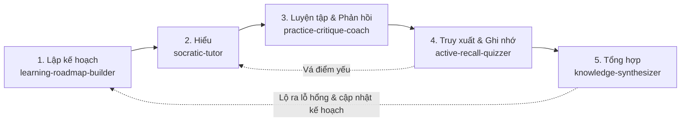
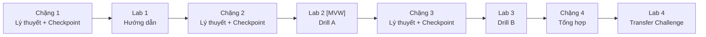

# LearningSkill

[English](README.md) | **Tiếng Việt**

[](#vòng-lặp-học-5-skill)
[](#áp-dụng-cho-mọi-lĩnh-vực)
[](#đa-ngôn-ngữ-mặc-định)
[](https://github.com/lochuung/learning-skill/actions/workflows/validate.yml)
[](LICENSE)

> **Biến AI agent của bạn thành hệ thống học tập cá nhân hóa, dựa trên bằng chứng khoa học, cho *mọi* lĩnh vực.** Từ lập trình, chứng chỉ, ngoại ngữ đến tài chính, thiết kế, viết lách và thuyết trình.

Phần lớn prompt học tập với AI chỉ cho ra dàn ý chung chung và những khối văn bản dài để đọc thụ động. **LearningSkill** là bộ 5 Agent Skill phối hợp với nhau, dựa trên khoa học nhận thức: **Backward Design, Socratic Tutoring, Deliberate Practice, Active Recall, Spaced Repetition và Feynman Technique**. Mục tiêu là giúp bạn nhớ lâu và áp dụng được, thay vì chỉ đọc cho xong.

## Mục lục

- [Vòng lặp học 5 skill](#vòng-lặp-học-5-skill)
- [Bố cục một tuần học: Chặng → Lab](#bố-cục-một-tuần-học-chặng--lab)
- [Áp dụng cho mọi lĩnh vực](#áp-dụng-cho-mọi-lĩnh-vực)
- [Khoa học học tập tích hợp sẵn](#khoa-học-học-tập-tích-hợp-sẵn)
- [Cài đặt](#cài-đặt)
- [Sử dụng](#sử-dụng)
- [Ví dụ](#ví-dụ)
- [Quy trình một tuần học hoàn chỉnh](#quy-trình-một-tuần-học-hoàn-chỉnh)
- [Cấu trúc repository](#cấu-trúc-repository)
- [Kiểm tra (Validate)](#kiểm-tra-validate)
- [Đóng góp](#đóng-góp)
- [Giấy phép](#giấy-phép)

---

## Vòng lặp học 5 skill

Mỗi skill phụ trách một giai đoạn của quá trình thành thạo. Bạn có thể dùng riêng từng skill hoặc dùng cả vòng lặp khép kín:



| # | Skill | Giai đoạn | Chức năng | Prompt ví dụ |
| :-: | :--- | :--- | :--- | :--- |
| 1 | **[learning-roadmap-builder](skills/learning-roadmap-builder/SKILL.md)** | **Lập kế hoạch** | Phỏng vấn bạn, kiểm tra trình độ thật bằng câu hỏi thăm dò, phân loại lĩnh vực, rồi tạo repo Markdown nhiều giai đoạn đã cá nhân hóa (ghi chú theo chặng, lab thực hành đúng lĩnh vực, rubric, tuần tối thiểu MVW, bảng theo dõi tiến độ). | *"Lập lộ trình 10 tuần học phân tích báo cáo tài chính từ con số 0, 5 giờ/tuần."* |
| 2 | **[socratic-tutor](skills/socratic-tutor/SKILL.md)** | **Hiểu** | Dạy tương tác bất kỳ khái niệm nào bằng ví dụ tương tự từ nền tảng của bạn, sơ đồ, ví dụ có lời giải và các câu hỏi Socratic ngắn, thay vì đổ một khối chữ. | *"Dạy tôi cách định giá quyền chọn (options) theo kiểu tương tác. Tôi là kỹ sư phần mềm."* |
| 3 | **[practice-critique-coach](skills/practice-critique-coach/SKILL.md)** | **Luyện tập & Phản hồi** | Tạo bài tập luyện có chủ đích tăng dần độ khó, chạy nhập vai/mô phỏng, và chấm bài theo rubric 1–3 có thể quan sát, kèm đề xuất viết lại cụ thể và một bài luyện 10 phút. | *"Chấm bản memo chiến lược sản phẩm của tôi theo rubric nghiêm ngặt"* hoặc *"Nhập vai đàm phán lương với tôi."* |
| 4 | **[active-recall-quizzer](skills/active-recall-quizzer/SKILL.md)** | **Truy xuất & Ghi nhớ** | Chạy quiz đóng sách thích ứng, mini-mock có bấm giờ và ôn tập ngắt quãng theo thang Bloom. Giải thích vì sao đáp án nhiễu sai và ghi lại điểm yếu. | *"Kiểm tra tôi về Tuần 2, đừng cho xem đáp án trước, và theo dõi điểm yếu của tôi."* |
| 5 | **[knowledge-synthesizer](skills/knowledge-synthesizer/SKILL.md)** | **Củng cố** | Chạy kiểm tra Feynman Teach-Back và chắt lọc ghi chú/tài liệu lộn xộn thành Atomic Concept Note, bảng so sánh, sơ đồ khái niệm Mermaid và cheat sheet một trang. | *"Kiểm tra phần giải thích Feynman của tôi về TCP congestion control"* hoặc *"Biến các ghi chú này thành cheat sheet 1 trang."* |

---

## Bố cục một tuần học: Chặng → Lab

Mỗi tuần được chia thành **3–4 Chặng** (*Stage*) thay vì một trang lý thuyết dài. Cuối mỗi chặng có liên kết tới đúng **Lab** trong file thực hành, nên bạn luôn thực hành ngay sau khi học phần lý thuyết tương ứng.



- `Week-NN-<Title>.md` (hoặc `Tuan-NN-<Title>.md`) chứa các chặng. Cuối mỗi chặng có hộp `🧪 Next: Lab k` liên kết tới `Week-NN-Practice.md#lab-k`.
- `Week-NN-Practice.md` chứa các Lab. Đầu mỗi Lab có dòng `Covers: Stage k` liên kết ngược về chặng.
- Chặng *k* ứng với Lab *k*. Đúng một Lab được gắn thẻ `[MVW]` cho những tuần bận.

Xem ví dụ thật: [Ghi chú Tuần 1](examples/financial-analysis-sample/Week-01-Reading-the-3-Statements.md) và [Thực hành Tuần 1](examples/financial-analysis-sample/Week-01-Practice.md).

---

## Áp dụng cho mọi lĩnh vực

Khác với các mẫu học tập chỉ dành cho IT, mọi skill trong bộ này điều chỉnh tiến trình, bài tập và rubric theo **6 nhóm lĩnh vực**:

| Nhóm | Ví dụ | Cách luyện tập & đánh giá thích nghi |
| :--- | :--- | :--- |
| **Kỹ thuật / Công cụ** | Rust, Cloud, SQL, Excel, CAD | Lab có hướng dẫn, coding kata, sửa lỗi có chủ đích, capstone và bảo vệ kiến trúc |
| **Thi cử / Học thuật** | IELTS, CFA, PMP, AWS, thi đại học | Giáo trình theo trọng số, bài phân biệt khái niệm, thi thử bấm giờ, nhật ký lỗi, cheat sheet |
| **Ngoại ngữ** | Tiếng Anh, Nhật, Pháp, Tây Ban Nha | SRS hằng ngày, shadowing, sentence mining, nhập vai giao tiếp, rubric kiểu CEFR |
| **Sáng tạo / Thủ công** | UI/UX, viết lách, nhiếp ảnh, âm nhạc, nấu ăn | Phân tích tác phẩm bậc thầy, bài luyện nhỏ có ràng buộc, brief gốc, rubric thủ công, portfolio |
| **Kinh doanh / Tri thức** | Tài chính, marketing, PM, luật, lịch sử | Áp dụng framework, phân tích công ty, memo kiểu Feynman, mô phỏng ra quyết định |
| **Thể chất / Kỹ năng mềm** | Nói trước đám đông, đàm phán, lãnh đạo, cờ vua | Luyện kỹ thuật riêng lẻ, nhập vai theo kịch bản, thực hành thật, rubric tự xem lại bản ghi |

---

## Khoa học học tập tích hợp sẵn

- **Cá nhân hóa dựa trên chẩn đoán**: không tin hoàn toàn vào tự đánh giá. Dùng 2–4 câu thăm dò cụ thể, chọn ví dụ tương tự theo nền tảng của bạn và rút gọn phần bạn đã biết.
- **Backward Design**: bắt đầu từ *Definition of Done* (điều bạn thực sự làm được hoặc chứng minh được) rồi thiết kế ngược lại.
- **Deliberate Practice + rubric quan sát được**: mỗi bài tập đi từ *Hướng dẫn → Drill ở rìa năng lực → Transfer Challenge không hướng dẫn*, có tiêu chí chấm 1–3 khách quan và prompt AI Critique để copy-paste cho người tự học.
- **Active Recall & Spaced Repetition**: câu hỏi đóng sách, ôn xen kẽ các tuần trước (`N-1`, `N-3`) và lịch ôn kiểu Leitner (`1d → 3d → 7d → 14d → 30d`).
- **Duy trì thói quen (MVW)**: mỗi tuần có một **Minimum Viable Week** (bài rút gọn khoảng 30–40%) để tuần bận không làm đứt chuỗi học.

---

## Cài đặt

Mọi skill tuân theo chuẩn mở [Agent Skills](https://agentskills.io) (`skills/<tên-skill>/SKILL.md` + `references/`), nên dùng được trên **hầu hết các AI agent phổ biến**.

### Cách A: Cài bằng một dòng lệnh (khuyến nghị, mọi agent)

```bash
# Cài tương tác (chọn skill, agent đích, phạm vi project hoặc global)
npx skills add lochuung/learning-skill

# Cài global cho mọi project
npx skills add lochuung/learning-skill -g

# Chỉ cài một skill
npx skills add lochuung/learning-skill --skill learning-roadmap-builder
```

### Cách B: Cài thủ công theo từng agent

Clone repository một lần:

```bash
git clone https://github.com/lochuung/learning-skill.git
```

Sau đó chép `learning-skill/skills/*` vào thư mục skills của agent bạn dùng:

| Agent | Phạm vi project | Phạm vi global |
| :--- | :--- | :--- |
| **Antigravity** | `.agents/skills/` | `~/.gemini/config/skills/` |
| **Claude Code** | `.claude/skills/` | `~/.claude/skills/` |
| **Cursor** | `.cursor/skills/` *(hoặc `.agents/skills/`)* | `~/.cursor/skills/` |
| **OpenAI Codex** | `.agents/skills/` | `~/.codex/skills/` |
| **Gemini CLI** | `.gemini/skills/` *(hoặc `.agents/skills/`)* | `~/.gemini/skills/` |
| **GitHub Copilot** | `.github/skills/` *(hoặc `.agents/skills/`)* | `~/.copilot/skills/` |
| **Windsurf** | `.windsurf/skills/` | `~/.codeium/windsurf/skills/` |
| **OpenCode / Roo / Cline** | `.agents/skills/` *(hoặc `.opencode/`, `.roo/`, `.cline/skills/`)* | `~/.config/opencode/skills/` |

Lệnh chép mẫu (thay `<target-dir>` bằng đường dẫn trong bảng trên):

```bash
# macOS / Linux
mkdir -p <target-dir> && cp -r learning-skill/skills/* <target-dir>/
```

```powershell
# Windows (PowerShell)
New-Item -ItemType Directory -Force -Path <target-dir>
Copy-Item -Recurse -Force learning-skill\skills\* <target-dir>\
```

---

## Sử dụng

Chỉ cần nói chuyện tự nhiên. Agent tự kích hoạt đúng skill dựa trên ý định của bạn:

```text
"Giúp tôi lập lộ trình 8 tuần học UX Design. Tôi là frontend dev, có 6 giờ/tuần."
```

### Đa ngôn ngữ mặc định

Toàn bộ hướng dẫn trong skill được viết bằng tiếng Anh để tương thích rộng. Mỗi skill tự **nhận diện và trả lời bằng ngôn ngữ của bạn** (tiếng Việt, tiếng Anh, tiếng Nhật, v.v.) và giữ nguyên thuật ngữ chuyên ngành. Với tiếng Việt, tên file dùng tiền tố `Tuan-01-...`.

---

## Ví dụ

Muốn xem các skill này tạo ra gì cho chủ đề **không phải lập trình**?

- **[Phân tích báo cáo tài chính: lộ trình mẫu](examples/financial-analysis-sample/README.md)**: lộ trình 6 tuần cá nhân hóa cho một kỹ sư phần mềm học đầu tư cá nhân (có ví dụ tương tự, hiệu chuẩn bằng chẩn đoán và MVW).
- **[Ghi chú Tuần 1 (các Chặng)](examples/financial-analysis-sample/Week-01-Reading-the-3-Statements.md)**: lý thuyết chia 4 chặng, mỗi chặng có Checkpoint và liên kết tới Lab tương ứng.
- **[Thực hành Tuần 1 (các Lab)](examples/financial-analysis-sample/Week-01-Practice.md)**: Lab Map, Warm-Up Retrieval, lab `[MVW]`, Transfer Challenge, rubric 1–3 quan sát được và prompt AI Critique.
- **[Walkthrough 5 skill từ đầu đến cuối (Đàm phán)](examples/5-skill-walkthrough.md)**: cách 5 skill kết nối trong một tuần học kỹ năng mềm.

---

## Quy trình một tuần học hoàn chỉnh

Đây là cách một người học dùng cả 5 skill trong một tuần điển hình:

1. **Chủ nhật (Lập kế hoạch):** chạy `learning-roadmap-builder` để tạo repo học tập cá nhân hóa (`README.md` + ghi chú và thực hành `Week-01`).
2. **Thứ Hai–Thứ Ba (Hiểu):** kẹt ở một khái niệm trong Tuần 1? Hỏi `socratic-tutor`: *"Giải thích discounted cash flow theo kiểu tương tác, dùng ví dụ tương tự gói thuê bao SaaS."*
3. **Thứ Tư–Thứ Năm (Luyện tập):** làm các Lab của Tuần 1 (bắt đầu từ lab `[MVW]`) và Transfer Challenge, rồi đưa bài cho `practice-critique-coach` để nhận bảng điểm rubric 1–3, đề xuất viết lại và bài sửa lỗi 10 phút.
4. **Thứ Sáu (Truy xuất):** chạy `active-recall-quizzer` để làm quiz đóng sách 10 phút, trộn Tuần 1 với các điểm yếu cũ. Câu sai được xếp lịch ôn ngắt quãng.
5. **Thứ Bảy (Tổng hợp):** dùng `knowledge-synthesizer` để làm Feynman teach-back 5 phút và lưu bảng so sánh hoặc cheat sheet 1 trang vào repo trước khi sang Tuần 2.

---

## Cấu trúc repository

```text
learning-skill/
├── README.md                         # English
├── README.vi.md                      # Tiếng Việt
├── LICENSE
├── .gitignore
├── .github/
│   └── workflows/
│       └── validate.yml              # CI: kiểm tra frontmatter và liên kết Markdown
├── scripts/
│   └── validate_skills.py            # Trình kiểm tra skill (chạy local và CI)
├── examples/
│   ├── 5-skill-walkthrough.md        # Demo 5 skill: đàm phán
│   └── financial-analysis-sample/    # Lộ trình phi IT + ghi chú (Chặng) + thực hành (Lab)
│       ├── README.md
│       ├── Week-01-Reading-the-3-Statements.md
│       └── Week-01-Practice.md
└── skills/
    ├── learning-roadmap-builder/
    │   ├── SKILL.md
    │   └── references/
    │       ├── interview-guide.md
    │       ├── roadmap-design-principles.md
    │       ├── practice-design-guide.md
    │       └── templates.md
    ├── socratic-tutor/
    │   ├── SKILL.md
    │   └── references/
    │       └── socratic-patterns.md
    ├── practice-critique-coach/
    │   ├── SKILL.md
    │   └── references/
    │       └── rubric-and-roleplay-guide.md
    ├── active-recall-quizzer/
    │   ├── SKILL.md
    │   └── references/
    │       └── question-design-and-srs.md
    └── knowledge-synthesizer/
        ├── SKILL.md
        └── references/
            └── synthesis-templates.md
```

---

## Kiểm tra (Validate)

Trước khi mở Pull Request, chạy trình kiểm tra để bảo đảm frontmatter hợp lệ và không có liên kết Markdown nào bị hỏng (CI cũng chạy lệnh này):

```bash
python scripts/validate_skills.py
```

---

## Đóng góp

Mọi đóng góp đều được chào đón. Có thể là một skill học tập mới (ví dụ *Book & Paper Distiller*, *Spaced-Repetition Deck Generator*), rubric riêng cho từng lĩnh vực tốt hơn, hoặc câu hỏi chẩn đoán sắc bén hơn:

1. Giữ `SKILL.md` ngắn gọn (khoảng 70–110 dòng) và đẩy rubric/template dài vào `references/` (tiết lộ thông tin dần dần).
2. Viết `description` trong YAML frontmatter rõ ràng, không chồng chéo, để agent biết chính xác khi nào kích hoạt từng skill.
3. Bảo đảm mỗi skill chạy tốt cho cả lĩnh vực kỹ thuật lẫn phi kỹ thuật.
4. Chạy `python scripts/validate_skills.py` rồi mở Pull Request, mô tả vấn đề sư phạm mà thay đổi của bạn giải quyết.

Phát hiện lỗi hoặc có ý tưởng? Hãy [mở một issue](https://github.com/lochuung/learning-skill/issues).

---

## Giấy phép

Phát hành theo giấy phép [MIT](LICENSE). Bạn được tự do sử dụng, chỉnh sửa và chia sẻ lại.
