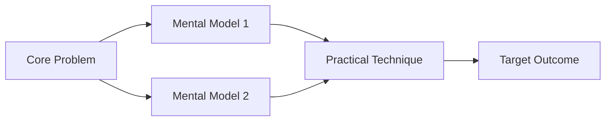

# Knowledge Synthesis Templates

Adapt headings to the user's language. Keep every artifact scannable in under 60 seconds.

## 1. Atomic Concept Note

```markdown
# <Concept Name>

> **One-sentence essence:** <Plain-language definition without jargon>

## Why It Matters
<The real problem this solves or decision it unlocks>

## Analogy
<Bridge to a familiar everyday or cross-domain concept>

## How It Works
<3–5 concise bullets or a small Mermaid diagram>

## Concrete Example
<1 realistic scenario showing the concept in action>

## Common Misconceptions
- **Myth:** ... → **Reality:** ...

## Connections
- **Builds on:** <prerequisite>
- **Often confused with:** <look-alike + 1-line difference>
- **Leads to:** <next concept>
```

## 2. Comparison Matrix (Confusable Concepts)

```markdown
# <Concept A> vs <Concept B> (vs <Concept C>)

| Dimension | <Concept A> | <Concept B> |
| :--- | :--- | :--- |
| **Core purpose** | ... | ... |
| **Best used when** | ... | ... |
| **Avoid when** | ... | ... |
| **Key trade-off** | ... | ... |
| **Classic trap** | ... | ... |

**Quick Decision Rule:** If `<condition>`, pick **A**; if `<condition>`, pick **B**.
```

## 3. Concept Map (Mermaid)

Use `flowchart TD` / `flowchart LR` (quote labels with special characters). Keep to **8–15 nodes max** so it stays readable:

```markdown

```

## 4. One-Page Cheat Sheet

```markdown
# Cheat Sheet: <Topic / Phase>

## 1. Core Mental Models (3–5 rules)
1. ...

## 2. Key Numbers / Formulas / Thresholds *(omit if not applicable)*
| Item | Value / Rule | Why It Matters |
| :--- | :--- | :--- |

## 3. Decision Triggers (If you see X → Do Y)
| Signal / Keyword / Situation | Best Action / Answer |
| :--- | :--- |

## 4. Top 5 Pitfalls to Avoid
1. ...
```
